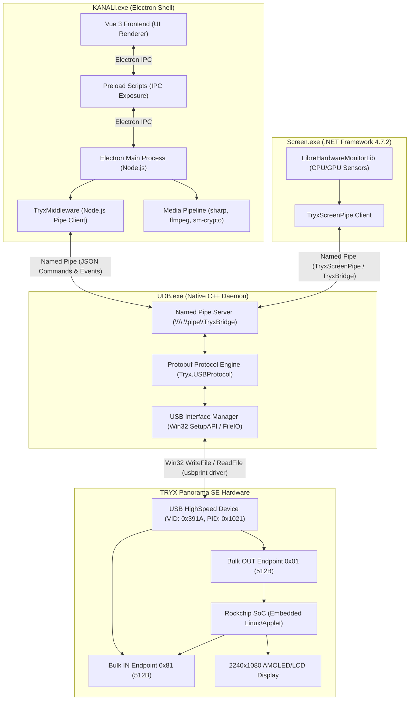

# KANALI Application Architecture

## 1. Executive Summary

TRYX KANALI for Windows (v2.6.0) is a multi-tier hybrid architecture consisting of:
1. **Frontend / Application Shell**: An Electron (Node 18+ / Chromium / Vue 3 / Vite) desktop application (`KANALI.exe`).
2. **Hardware Telemetry & Sensor Engine**: A .NET Framework 4.7.2 background service (`Screen.exe`) that continuously queries CPU, GPU, memory, and motherboard sensors using `LibreHardwareMonitorLib` and monitors RGB fan MCUs.
3. **Hardware USB Daemon & Middleware**: A 64-bit native C++ background daemon (`UDB.exe`) that maintains an exclusive handle to the USB device interface (`usbprint`), implements the Google Protobuf-based communication protocol, and exposes a Windows Named Pipe (`\\.\pipe\TryxBridge`) to the frontend and helper services.
4. **Media Processing Pipeline**: A combination of `ffmpeg.exe`, native DLLs (`MediaStation.dll`, `MediaX.dll`, OpenCV 4.3.0), and Node libraries (`sharp`, `sm-crypto`) for video cropping, H.264 transcoding (2240 × 1080), and Chinese commercial cryptography (SM4/SM3) handling.

---

## 2. Process & Component Architecture

---

## 3. Component Inventory & SHA-256 Hashes

| File Path | Description | Framework / Stack | SHA-256 Digest |
| :--- | :--- | :--- | :--- |
| `C:\Program Files\KANALI\KANALI.exe` | Main Electron Application Launcher | Electron / Chromium | `26FC4A0068BF2D9903A9C828FEAF5FB715A9C15B5031FC9848A659ACC9D7A4B3` |
| `C:\Program Files\KANALI\resources\app.asar` | Application bundle (JS, Vue, assets) | Node.js / Vite / Vue 3 | `17DCC2CC604D32C9AFB2B5F72BBB2092E25444FC4D4AD6CEE3246B6DA580DB6A` |
| `C:\Program Files\KANALI\resources\Connect\Screen.exe` | System telemetry & hardware monitor | .NET Framework 4.7.2 | `8BF702CD4E750A2E4D1C0A7745A212A0352B8D6F3D2A2035261C47E691691794` |
| `C:\Program Files\KANALI\resources\Connect\tm\UDB.exe` | USB device communication daemon | Native C++ (MSVC x64) | `7E4999AA66E3FF0B049D44800FB4C0F010B100C2D75F14AED44EC0C0995AF60C` |
| `C:\Program Files\KANALI\resources\Connect\tm\usb_dl.exe` | Firmware / binary download utility | Native C++ (MSVC x64) | `EEA22A27445E27EF557D3CD115AFF8854706BF0FCB25F5C1EEDD8A6A43B716C5` |
| `C:\Program Files\KANALI\resources\driver\rkDriver\rkdeveloptool.exe` | Rockchip USB download & flashing tool | Native x64 | `3C43B205D97E05C5DC7969E70F7E04C74805A1961A602B73FD8035D55BA32A60` |
| `C:\Program Files\KANALI\MediaStation.dll` | Native media transcoding & clip helper | Native C++ (MSVC x64) | `E57041D992F5441E6669CEF4B0E8FA3ED67123A79E2A895F69F218DA4949576B` |
| `C:\Program Files\KANALI\MediaX.dll` | Video encoding and scaling helper | Native C++ (MSVC x64) | `9356FEAE57C783CD6A0B1BE66136BE14725043B03848E1E57A8B6324D6F63820` |

---

## 4. Inter-Process Communication (IPC) Mechanisms

1. **`\\.\pipe\TryxBridge`**:
   - Primary duplex control pipe managed by `UDB.exe`.
   - Protocol: UTF-8 JSON text messages framed with `{ "header": { "cmd": "...", "sn": "..." }, ... }`.
   - Used by `KANALI.exe` and `Screen.exe` to trigger actions and receive async hardware notifications.

2. **`\\.\pipe\TryxScreenPipe`**:
   - Secondary pipe connecting `KANALI.exe` to `Screen.exe`.
   - Coordinates sensor polling intervals and active telemetry tags.

3. **Shared Memory (`Local\TryxMediaPush_<Session>`)**:
   - High-throughput memory-mapped file buffer for live screen streaming and dynamic frame transfers.

---

## 5. Device Communication Ownership & Boundary

- **UI Isolation**: The UI (`KANALI.exe`) has **zero direct device access**. It never calls Win32 USB or SetupAPI functions directly.
- **Single Owner**: `UDB.exe` exclusively owns the USB communication. It discovers the device path via `SetupDiGetClassDevsW` with the USBPRINT interface GUID, opens the device with `CreateFileW`, and dispatches transfers using `WriteFile` and `ReadFile` on Endpoints `0x01` (OUT) and `0x81` (IN).
- **Protocol Encapsulation**: High-level JSON commands from the UI (e.g., `CMD_Set_RunConfig`, `CMD_File_Transmit`) are translated by `UDB.exe` into binary Protobuf packets (`Tryx.USBProtocol` / `Tryx.KanaliProtocol`) before transmission over USB.
