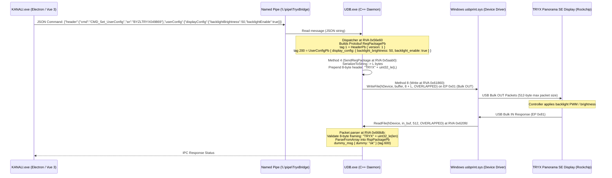

# TRYX Panorama SE Protocol Specification: Transport & Brightness Transaction

## 1. Architectural Overview & Transaction Flow

This document details the reverse-engineered USB wire protocol, transport layer, and end-to-end transaction flow for controlling display brightness on the **TRYX Panorama SE ARGB 360** (Rockchip `PASE`, USB `391A:1021`).

### 1.1 Complete End-to-End Control Path



---

## 2. USB Transport & Device Interface

### 2.1 Device Identifiers & Binding

| Attribute | Value | Verification Source |
| :--- | :--- | :--- |
| **Vendor ID (VID)** | `0x391A` | USB Device Descriptor |
| **Product ID (PID)** | `0x1021` | USB Device Descriptor |
| **Device Revision (bcdDevice)** | `0x0310` (v3.10) | USB Device Descriptor |
| **Device Serial Number** | `7DA3448149D8E9DA` | USB String Descriptor 3 |
| **Manufacturer String** | `RK` (Rockchip) | USB String Descriptor 1 |
| **Product String** | `PASE` (Panorama SE) | USB String Descriptor 2 |
| **USB Class** | `0x07` (USB Printer Class) | USB Interface Descriptor |
| **USB Subclass / Protocol** | `0x01` (Printer) / `0x02` (Bi-directional) | USB Interface Descriptor |
| **Driver Service** | `usbprint` (`usbprint.sys`) | Windows Device Manager / PnP |
| **Active Device Interface Path** | `\\?\usb#vid_391a&pid_1021#7da3448149d8e9da#{a5dcbf10-6530-11d2-901f-00c04fb951ed}` | `UDB.exe` runtime log & live query |
| **Interface Class GUID** | `{a5dcbf10-6530-11d2-901f-00c04fb951ed}` (`GUID_DEVINTERFACE_USB_DEVICE`) | SetupAPI Device Enumeration |

### 2.2 Handle Acquisition & Exclusivity

In `UDB.exe`, device handles are acquired at RVA `0x56630` and `0x68243` using standard Win32 `CreateFileW`:

```cpp
HANDLE hDevice = CreateFileW(
    L"\\\\?\\usb#vid_391a&pid_1021#7da3448149d8e9da#{a5dcbf10-6530-11d2-901f-00c04fb951ed}",
    GENERIC_READ | GENERIC_WRITE,                  // 0xC0000000
    FILE_SHARE_READ | FILE_SHARE_WRITE,            // 0x00000003 (Shared!)
    NULL,                                          // Default security
    OPEN_EXISTING,                                 // 3
    FILE_ATTRIBUTE_NORMAL | FILE_FLAG_OVERLAPPED,  // 0x40000080 (Asynchronous)
    NULL
);
```

> [!IMPORTANT]
> **Exclusivity Disproven by Live Hardware Evidence**:
> `UDB.exe` specifies `FILE_SHARE_READ | FILE_SHARE_WRITE` (`0x00000003`). On 2026-11-10, an independent test process concurrently opened `hDevice` (`0x208`, `GetLastError = 0`) while `UDB.exe` was running and holding its device handle. Exclusive locking is **not** enforced by the driver or the application. However, concurrent bulk transfers from multiple processes would interleave USB packets; Lumien should run standalone without KANALI active to ensure deterministic transfer ordering.

### 2.3 Endpoints

- **Bulk OUT (`0x01`)**: Transfers command packets and frame data from host to display. `wMaxPacketSize = 512` bytes.
- **Bulk IN (`0x81`)**: Receives command acknowledgments and status reports from display to host. `wMaxPacketSize = 512` bytes.

---

## 3. Wire Framing Protocol

All communication between host and display across Endpoint `0x01` and Endpoint `0x81` is encapsulated in a standardized 8-byte framing container.

### 3.1 8-Byte Framing Header

| Byte Offset | Field Name | Type | Value / Description |
| :--- | :--- | :--- | :--- |
| `0x00`..`0x03` | `magic` | 4 bytes (ASCII) | `0x54, 0x52, 0x59, 0x58` (`"TRYX"`) in little-endian (`0x58595254`) |
| `0x04`..`0x07` | `payload_len` | `uint32` LE | Length $L$ of the following Protobuf payload in bytes |
| `0x08`..`0x08+L-1` | `payload` | bytes ($L$) | Serialized Google Protobuf message (`ReqPackagePb` or `RspPackagePb`) |

- **Magic Prefix Verification**: Disassembled at `UDB.exe` RVA `0x5aca0` (`mov dword ptr [rbp - 8], 0x58595254`) and checked on receive at RVA `0x668db`.
- **Length Field**: Disassembled at `UDB.exe` RVA `0x5acaa`–`0x5acbf` (extracts 4 bytes of length in little-endian order).
- **Integrity**: CRC32 is supported by the Protobuf schema (`HeaderPb.payload_crc32 = 3`), but in practice for brightness and configuration commands, `payload_crc32` is omitted (defaults to 0), and hardware USB CRC16/CRC32 provides link-layer integrity.

---

## 4. Protobuf Schema Definitions

Recovered directly from embedded `.proto` file descriptors in `UDB.exe` (Package `Tryx.USBProtocol` and `Tryx.Config`).

### 4.1 USB Protocol Envelope (`usb_protocol.proto`)

```protobuf
syntax = "proto3";
package Tryx.USBProtocol;

import "user_config.proto";

message HeaderPb {
  uint32 version = 1;       // Value = 1
  uint64 track_id = 2;      // Transaction correlation ID (0 for async config)
  uint32 payload_crc32 = 3;  // Optional payload CRC32 (0 when omitted)
}

message ReqPackagePb {
  HeaderPb header = 1;
  Tryx.Config.UserConfigPb user_config = 200;
  // Other oneof fields omitted for brevity:
  // ping = 10, sys_config = 201, run_config = 202, cooler_config = 203,
  // file_transmit_begin = 400, media_push_begin = 407, etc.
}

message DummyMsgPb {
  string dummy = 1;         // Value = "ok"
}

message ErrorPb {
  int32 code = 1;
  string message = 2;
}

message RspPackagePb {
  HeaderPb header = 1;
  ErrorPb error = 2;
  DummyMsgPb dummy_msg = 600;
  // Other response types: device_info = 500, user_config = 504, etc.
}
```

### 4.2 Configuration Schema (`user_config.proto`)

```protobuf
syntax = "proto3";
package Tryx.Config;

message DisplayConfigPb {
  bool backlight_enable = 1;        // Tag 1 (wire 0): Backlight power (true = ON)
  uint32 backlight_brightness = 2;  // Tag 2 (wire 0): Brightness level (0..100)
  bool mirror = 3;                  // Tag 3 (wire 0): Mirror display
  uint32 ui_rotation = 4;           // Tag 4 (wire 0): UI text rotation (0, 90, 180, 270)
  uint32 media_rotation = 5;        // Tag 5 (wire 0): Video/canvas rotation
}

message UserConfigPb {
  // Field 1: PowerOnConfigPb poweron_config = 1;
  // Field 2: StandbyConfigPb standby_config = 2;
  // Field 3: WorkConfigPb work_config = 3;
  // Field 4: FilterConfigPb filter_config = 4;
  DisplayConfigPb display_config = 5;  // Tag 5 (wire 2): Display backlight & rotation
  // Field 6: LightConfigPb light_config = 6;
}
```

---

## 5. Annotated Hexadecimal Wire Frames

### 5.1 Request: Set Brightness to 50% (`backlight_enable = true`, `backlight_brightness = 50`)

Total wire packet length: **21 bytes**.

```text
54 52 59 58 0d 00 00 00 0a 02 08 01 c2 0c 06 2a 04 08 01 10 32
```

#### Detailed Byte Breakdown:

| Offset | Hex Bytes | Field / Item | Interpretation |
| :--- | :--- | :--- | :--- |
| **0x00** | `54 52 59 58` | `magic` | ASCII `"TRYX"` (4-byte container magic) |
| **0x04** | `0d 00 00 00` | `payload_len` | `0x0000000d` (13 bytes Protobuf payload) |
| **0x08** | `0a` | `ReqPackagePb.header` tag | Field 1, wire type 2 (Length-delimited): `(1 << 3) | 2 = 0x0A` |
| **0x09** | `02` | `header` length | 2 bytes length |
| **0x0A** | `08 01` | `HeaderPb.version` | Field 1, wire type 0 (Varint): `(1 << 3) | 0 = 0x08`, value = `1` |
| **0x0C** | `c2 0c` | `ReqPackagePb.user_config` tag | Field 200, wire type 2: `(200 << 3) | 2 = 1602 (0x642)`<br/>Varint: `0x42 | 0x80 = 0xC2`, `0x0C` |
| **0x0E** | `06` | `user_config` length | 6 bytes length |
| **0x0F** | `2a` | `UserConfigPb.display_config` tag | Field 5, wire type 2: `(5 << 3) | 2 = 42 (0x2A)` |
| **0x10** | `04` | `display_config` length | 4 bytes length |
| **0x11** | `08 01` | `DisplayConfigPb.backlight_enable` | Field 1, wire type 0: `(1 << 3) | 0 = 0x08`, value = `1` (`true`) |
| **0x13** | `10` | `DisplayConfigPb.backlight_brightness` tag | Field 2, wire type 0: `(2 << 3) | 0 = 0x10` |
| **0x14** | `32` | `backlight_brightness` value | Varint: `0x32` = **50%** |

---

### 5.2 Request Variations Across Brightness Values

Because values `0..100` fit in a single 7-bit varint byte (`0x00`..`0x64`), all single-byte brightness commands have an identical frame size of 21 bytes, differing only in the final byte:

| Brightness (%) | Final Byte (Hex) | Complete 21-Byte Wire Hex Frame |
| :---: | :---: | :--- |
| **0%** | `00` | `54 52 59 58 0d 00 00 00 0a 02 08 01 c2 0c 06 2a 04 08 01 10 00` |
| **10%** | `0a` | `54 52 59 58 0d 00 00 00 0a 02 08 01 c2 0c 06 2a 04 08 01 10 0a` |
| **28%** | `1c` | `54 52 59 58 0d 00 00 00 0a 02 08 01 c2 0c 06 2a 04 08 01 10 1c` |
| **42%** | `2a` | `54 52 59 58 0d 00 00 00 0a 02 08 01 c2 0c 06 2a 04 08 01 10 2a` |
| **50%** | `32` | `54 52 59 58 0d 00 00 00 0a 02 08 01 c2 0c 06 2a 04 08 01 10 32` |
| **75%** | `4b` | `54 52 59 58 0d 00 00 00 0a 02 08 01 c2 0c 06 2a 04 08 01 10 4b` |
| **100%** | `64` | `54 52 59 58 0d 00 00 00 0a 02 08 01 c2 0c 06 2a 04 08 01 10 64` |

---

### 5.3 Response: Acknowledgment (`RspPackagePb`)

Total wire packet length: **21 bytes**.

```text
54 52 59 58 0d 00 00 00 0a 02 08 01 12 00 c2 25 04 0a 02 6f 6b
```

#### Detailed Byte Breakdown:

| Offset | Hex Bytes | Field / Item | Interpretation |
| :--- | :--- | :--- | :--- |
| **0x00** | `54 52 59 58` | `magic` | ASCII `"TRYX"` (4-byte container magic) |
| **0x04** | `0d 00 00 00` | `payload_len` | `0x0000000d` (13 bytes Protobuf payload) |
| **0x08** | `0a` | `RspPackagePb.header` tag | Field 1, wire type 2: `0x0A` |
| **0x09** | `02` | `header` length | 2 bytes length |
| **0x0A** | `08 01` | `HeaderPb.version` | Field 1, wire type 0, value = `1` |
| **0x0C** | `12 00` | `RspPackagePb.error` | Field 2, wire type 2: `(2 << 3) | 2 = 0x12`, length = `0` (no error) |
| **0x0E** | `c2 25` | `RspPackagePb.dummy_msg` tag | Field 600, wire type 2: `(600 << 3) | 2 = 4802 (0x12C2)`<br/>Varint: `(0x42 | 0x80) = 0xC2`, `0x25` |
| **0x10** | `04` | `dummy_msg` length | 4 bytes length |
| **0x11** | `0a` | `DummyMsgPb.dummy` tag | Field 1, wire type 2: `0x0A` |
| **0x12** | `02` | `dummy` length | 2 bytes string length |
| **0x13** | `6f 6b` | `dummy` string | ASCII `"ok"` |

---

## 6. Disassembly & Runtime Evidence Reference Table

| Target | Binary | Address / Location | Evidence Description |
| :--- | :--- | :--- | :--- |
| **NamedPipe IPC Handler** | `UDB.exe` | RVA `0x56e60` | Receives JSON `CMD_Set_UserConfig` and logs `[Pipe] cmd=CMD_Set_UserConfig sn={}` |
| **Protobuf Message Alloc** | `UDB.exe` | RVA `0x56f60`, `0x56fa8` | Instantiates `HeaderPb` (RVA `0x42190`) and `UserConfigPb` (RVA `0x4c300`) on stack |
| **Oneof Tag Selector** | `UDB.exe` | RVA `0x56f9c` | `mov dword ptr [rbp + 0xd94], 0xc8` (Tag `200` = `user_config`) |
| **Framing Prefix Prepend** | `UDB.exe` | RVA `0x5ac9c` | `mov dword ptr [rbp - 8], 0x58595254` (`"TRYX"`) |
| **Payload Length Prepend** | `UDB.exe` | RVA `0x5acaa`–`0x5acbf` | Writes 4-byte little-endian payload length $L$ |
| **USB Bulk OUT WriteFile** | `UDB.exe` | RVA `0x61a41` | Calls `WriteFile` with `OVERLAPPED` struct to Bulk OUT endpoint `0x01` |
| **USB Bulk IN ReadFile** | `UDB.exe` | RVA `0x620fd` | Calls `ReadFile` with `OVERLAPPED` struct from Bulk IN endpoint `0x81` |
| **Response Frame Parsing** | `UDB.exe` | RVA `0x668db`–`0x669b8` | Strips 8-byte `"TRYX"` header and invokes `google::protobuf::MessageLite::ParseFromArray` |
| **Live Device Open Test** | Python / Host | `0x208` handle | Win32 `CreateFileW` with `FILE_SHARE_READ | FILE_SHARE_WRITE` succeeded while `UDB.exe` was running |

---

## 7. Widget & Telemetry Wire Protocol (`lv_gui.proto`)

### 7.1 Layout Configuration (`RunConfigPb`, Tag 201)

Used to instantiate and configure LVGL widget containers and labels on the device display plane.

**Wire Packaging in `ReqPackagePb`**:
- Field 1 (`header`): `HeaderPb` (`version = 1`) -> `08 01`
- Field 201 (`run_config`): Varint tag `(201 << 3) | 2 = 1610 (0x064A)` -> `ca 0c`
  - Submessage: `RunConfigPb` containing repeated `LabelGroupPb` (tag 1: `0a`)

```text
54 52 59 58 [4-byte Little-Endian Length L] 0a 02 08 01 ca 0c [RunConfigPb Length] 0a ...
```

#### Field Encoding in `LabelGroupPb`
- `group_id` (tag 1, varint): Unique container ID (e.g., 100, 200).
- `group_x` (tag 2, varint): Canvas X origin in $[0, 2240]$.
- `group_y` (tag 3, varint): Canvas Y origin in $[0, 1080]$.
- `group_width` (tag 4, varint): Bounding box width.
- `group_height` (tag 5, varint): Bounding box height.
- `text_align` (tag 6, varint): `0 = Left`, `1 = Center`, `2 = Right`.
- `line_gap` (tag 7, zigzag sint32): Vertical line spacing (default: `-10` -> zigzag `19`).
- `labels` (tag 8, length-delimited): Repeated `LabelPb` structures.

#### Field Encoding in `LabelPb`
- `label_id` (tag 1, varint): Unique element ID (e.g., 101, 102).
- `line` (tag 2, varint): Line index (0 = primary row, 1 = subtitle row).
- `order` (tag 3, varint): Ordering within row.
- `gap_left` (tag 4, zigzag sint32): Left pixel offset.
- `background` (tag 5, varint): `0 = None`, `1 = Solid`, `2 = GradientH`, `3 = GradientV`.
- `background_color` (tag 6, varint): 24-bit integer RGB color.
- `text_font` (tag 8, string): Font identifier (e.g., `"roboto-regular"`).
- `text_size` (tag 9, varint): Font size in pixels/points.
- `text_color` (tag 10, varint): 24-bit integer RGB color.
- `text` (tag 11, string): Initial text string.

**Device Acknowledgment**: Responds with standard 21-byte `RspPackagePb` acknowledging completion:
```text
54 52 59 58 0d 00 00 00 0a 02 08 01 12 00 c2 25 04 0a 02 6f 6b
```

---

### 7.2 High-Frequency Runtime Updates (`BatchGroupLabelUpdatePb`, Tag 300)

Emitted by host telemetry loop at 1 Hz intervals to update label text in-place without touching widget geometry.

**Wire Packaging in `ReqPackagePb`**:
- Field 1 (`header`): `HeaderPb` (`version = 1`) -> `08 01`
- Field 300 (`batch_group_label_update`): Varint tag `(300 << 3) | 2 = 2402 (0x0962)` -> `e2 12`
  - Repeated `GroupLabelUpdatePb` (tag 1: `0a`):
    - `group_id` (tag 1, varint): Container ID.
    - `label_texts` (tag 2, length-delimited): Repeated `LabelTextUpdatePb` (tag `12`):
      - `label_id` (tag 1, varint): ID of label to update.
      - `text` (tag 2, string): New text value (e.g., `"45"`).

```text
54 52 59 58 [Length L] 0a 02 08 01 e2 12 [Batch Length] 0a [Group Length] 08 [group_id] 12 [Label Length] 08 [label_id] 12 [str_len] [str_bytes]
```

**Wire Size**: ~30 to 45 bytes total per 1-second tick for typical CPU/GPU metrics.

---

## 8. Media File Transfer Wire Protocol (`usb_protocol.proto`)

Transfers Annex B Raw H.264 video streams directly to embedded eMMC storage (`/userdata/default/`).

### 8.1 Step 1: Transfer Initiation (`FileTransmitBeginPb`, Tag 400)

**Request Wire Frame**:
- Field 1 (`header`): `08 01`
- Field 400 (`file_transmit_begin`): Varint tag `(400 << 3) | 2 = 3202 (0x0C82)` -> `82 19`
  - `file_name` (tag 1, bytes): Target filename string (e.g. `"asset.mp4.h264_2240x1080"`).
  - `file_size` (tag 2, varint): Exact file length in bytes.

**Device Response (`FileTransmitStatusPb`, Tag 800)**:
- Field 800 (`file_transmit_begin_status`): Varint tag `(800 << 3) | 2 = 6402 (0x1902)` -> `82 32`
  - `file_trans_status` (tag 1, varint): `0 = Success`, `1 = Failed`.

---

### 8.2 Step 2: Data Streaming (`FileTransmitDataPb`, Tag 401)

Data is split into sequential chunks (standard chunk size: 262,144 bytes / 256 KB).

**Request Wire Frame**:
- Field 1 (`header`): `08 01`
- Field 401 (`file_transmit_data`): Varint tag `(401 << 3) | 2 = 3210 (0x0C8A)` -> `8a 19`
  - `file_data` (tag 1, bytes): Binary chunk slice.

**Device Response (`FileTransmitDataStatusPb`, Tag 801)**:
- Field 801 (`file_transmit_data_status`): Varint tag `(801 << 3) | 2 = 6410 (0x190A)` -> `8a 32`
  - `file_trans_status` (tag 1, varint): `0 = Success`.

---

### 8.3 Step 3: Transfer Finalization (`FileTransmitEndPb`, Tag 402)

**Request Wire Frame**:
- Field 1 (`header`): `08 01`
- Field 402 (`file_transmit_end`): Varint tag `(402 << 3) | 2 = 3218 (0x0C92)` -> `92 19`
  - `file_type` (tag 1, bytes): ASCII `"media"` (`6d 65 64 69 61`).
  - `CRC` (tag 2, varint / fixed32): Standard IEEE 802.3 CRC32 checksum over the complete file.

**Device Response (`FileTransmitEndStatusPb`, Tag 802)**:
- Field 802 (`file_transmit_end_status`): Varint tag `(802 << 3) | 2 = 6418 (0x1912)` -> `92 32`
  - `file_trans_status` (tag 1, varint): `0 = Success`.
  - Confirms file written and flushed to eMMC.

---

### 8.4 Step 4: Playback Activation (`WorkConfigPb`, Tag 200 -> Tag 3)

Dispatched via `UserConfigPb` (tag 200) -> `work_config` (tag 3):
- `media_mode` (tag 1, varint): `0 = MediaMode_Single` (Full screen video loop).
- `loop_mode` (tag 2, varint): `0 = LoopMode_Single`.
- `single_mode_media_file` (tag 3, string): Name of uploaded asset on eMMC.

The Rockchip VPU immediately switches the hardware decoding context to the new file with zero display disruption.

