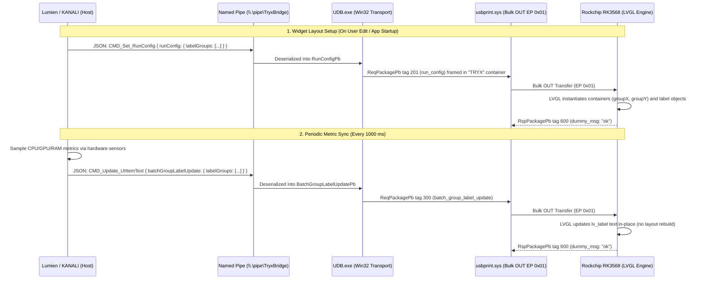

# TRYX Panorama SE Widget & Telemetry Pipeline Specification

## 1. Architectural Overview

The TRYX Panorama SE ARGB 360 LCD display renders on-screen telemetry widgets using a **hybrid client-server architecture**:
1. **Device-Side GUI Rendering Engine**: The onboard Rockchip RK3568 SoC executes an embedded Linux application that uses **LVGL (Light and Versatile Graphics Library)**. LVGL renders UI widgets into a hardware overlay plane (VO/VPSS) on top of the running H.264 video plane.
2. **Layout Definition (`RunConfigPb`)**: The host PC transmits structured widget layout definitions over USB Bulk OUT (EP `0x01`). Coordinates, dimensions, fonts, text colors, and label groupings are specified in display pixel units.
3. **Runtime High-Frequency Telemetry Updates (`BatchGroupLabelUpdatePb`)**: Metric data (CPU load, temperatures, clock speeds, dates, clock times) are collected by the host and pushed to the display as minimal string deltas at 1 Hz intervals. The device updates existing LVGL label text in place without re-rendering layouts or interrupting video decoding.



---

## 2. Protobuf Message Definitions (`lv_gui.proto`)

Extracted directly from compiled descriptors in `UDB.exe` (`Tryx.LVGui` package).

### 2.1 Label Definition (`LabelPb`)
Defines an individual text element within a widget group (e.g., metric label, value, or unit).

```protobuf
syntax = "proto3";
package Tryx.LVGui;

message LabelPb {
  enum enBackground {
    BackGround_None = 0;
    BackGround_Solid = 1;
    BackGround_GardientHorizontal = 2;
    BackGround_GardientVertical = 3;
  }

  uint32 label_id = 1;               // Unique numeric identifier (e.g. 101, 102, 103)
  uint32 line = 2;                   // Text line index within group (0 = primary, 1 = subtitle)
  uint32 order = 3;                  // Display order within line
  sint32 gap_left = 4;               // Left margin/padding in pixels
  enBackground background = 5;       // Background style
  uint32 background_color = 6;       // 24-bit RGB background fill color
  uint32 gradient_color = 7;         // 24-bit RGB gradient end color
  string text_font = 8;              // Font family name (e.g. "roboto-regular", "orbitron-regular")
  uint32 text_size = 9;              // Font size in points/pixels (e.g. 30, 160)
  uint32 text_color = 10;            // 24-bit RGB text color (e.g. 14474460 = #DCE4DC)
  string text = 11;                  // Initial or static text content
}
```

### 2.2 Widget Group Definition (`LabelGroupPb`)
Defines a bounding container for a group of related labels positioned on the display canvas.

```protobuf
message LabelGroupPb {
  enum enTextAlign {
    Left = 0;
    Center = 1;
    Right = 2;
  }

  uint32 group_id = 1;               // Group identifier (e.g. 100, 104, 200, 300)
  uint32 group_x = 2;                // Absolute X position on display canvas [0..2240]
  uint32 group_y = 3;                // Absolute Y position on display canvas [0..1080]
  uint32 group_width = 4;            // Container width in pixels
  uint32 group_height = 5;           // Container height in pixels
  enTextAlign text_align = 6;        // Alignment within bounding box (Left, Center, Right)
  sint32 line_gap = 7;               // Vertical spacing between lines in pixels (default: -10)
  repeated LabelPb labels = 8;       // Child labels belonging to this group
}
```

### 2.3 Layout Configuration (`RunConfigPb`)
Sent in `ReqPackagePb` field 201 (`run_config`).

```protobuf
message RunConfigPb {
  repeated LabelGroupPb label_groups = 1;
}
```

### 2.4 High-Speed Metric Delta Update (`BatchGroupLabelUpdatePb`)
Sent in `ReqPackagePb` field 300 (`batch_group_label_update`).

```protobuf
message LabelTextUpdatePb {
  uint32 label_id = 1;               // Target label identifier
  string text = 2;                   // New text string to display (e.g. "45")
}

message GroupLabelUpdatePb {
  uint32 group_id = 1;               // Target group identifier
  repeated LabelTextUpdatePb label_texts = 2;
}

message BatchGroupLabelUpdatePb {
  repeated GroupLabelUpdatePb label_groups = 1;
}
```

---

## 3. End-to-End Widget Lifecycle Trace

Correlated from KANALI runtime logs (`udb_2026-11-10.log`), decompiled `UDB.exe`, and `app.asar:out/main/index-1c57b0ec.js`.

### 3.1 Step 1: Layout Construction (`CMD_Set_RunConfig`)
When the user adds or repositions widgets in KANALI, the main process calculates pixel coordinates:
```javascript
// Excerpt from KANALI ScreenService.handleMessage:
let ue = N === "left" ? this.textOffsetX : this.screenWidth / A + this.textOffsetX;
let ce = j > 1 ? (this.screenHeight / (j + 1)) * (ye + 1) + ye * 10 : this.screenHeight / 2;
ce -= Math.round(C / 2);
```

#### Captured Wire Example (CPU Temp Widget):
```json
{
  "header": { "cmd": "CMD_Set_RunConfig", "sn": "BYZLTRYX049869" },
  "runConfig": {
    "labelGroups": [
      {
        "groupId": 100,
        "groupX": 60,
        "groupY": 260,
        "groupWidth": 2120,
        "groupHeight": 160,
        "textAlign": "Left",
        "lineGap": -10,
        "labels": [
          {
            "labelId": 101,
            "line": 1,
            "order": 0,
            "gapLeft": 13,
            "text": "CPU TEMP",
            "textSize": 30,
            "textFont": "roboto-regular",
            "textColor": 14474460
          },
          {
            "labelId": 102,
            "line": 0,
            "order": 1,
            "gapLeft": 0,
            "text": "43",
            "textSize": 160,
            "textFont": "roboto-regular",
            "textColor": 14474460
          },
          {
            "labelId": 103,
            "line": 0,
            "order": 2,
            "gapLeft": 0,
            "text": "°C",
            "textSize": 160,
            "textFont": "roboto-regular",
            "textColor": 14474460
          }
        ]
      }
    ]
  }
}
```
**USB Wire Dispatch**: `UDB.exe` serializes this into `ReqPackagePb` tag 201, prepends the 8-byte `"TRYX"` framing container, and writes it to Bulk OUT (EP `0x01`). The device responds with `RspPackagePb` tag 600 (`dummy_msg: "ok"`).

### 3.2 Step 2: Live Metric Updates (`CMD_Update_UIItemText`)
Every 1000 ms, `ScreenService.startSyncSystemInfoInterval` polls hardware sensors and emits:
```json
{
  "header": { "cmd": "CMD_Update_UIItemText", "sn": "BYZLTRYX049869" },
  "batchGroupLabelUpdate": {
    "labelGroups": [
      {
        "groupId": 100,
        "labelTexts": [
          { "labelId": 102, "text": "45" }
        ]
      }
    ]
  }
}
```
**USB Wire Dispatch**: Serialized into `ReqPackagePb` tag 300 (size: ~30 bytes). Device responds with `dummy_msg: "ok"`.

### 3.3 Step 3: Widget Removal
When all widgets are removed:
1. Host sends `CMD_Set_RunConfig` with an empty `labelGroups: []`.
2. Host stops the 1-second sync timer (`stopSyncSystemInfoInterval`).
3. Device LVGL clears the overlay plane.

---

## 4. Root-Cause Analysis: The Three-Indicator Limit

### 4.1 Finding: Pure Client-Side UI Checkbox Limit
Reverse engineering of the frontend bundle revealed the restriction in `out/renderer/assets/systemInfo-b52ef617.js` (line 1838):

```javascript
let l = [];
if (p.sysinfoDiaplayList.forEach(a => {
    a.check && l.push(a.label);
}), l.length >= 3) {
    const a = new Set(l);
    p.sysinfoDiaplayList.forEach(e => {
        e.disabled = !a.has(e.label);
    });
} else {
    p.sysinfoDiaplayList.forEach(a => {
        a.disabled = false;
    });
}
```

### 4.2 Architectural Classification
| Layer | Restriction Present? | Details |
| :--- | :--- | :--- |
| **Frontend UI (`systemInfo.vue`)** | **YES** (Hardcoded) | Disables unselected checkboxes as soon as `selectedCount >= 3`. |
| **Host Layout Generator (`ScreenService`)** | **NO** | Layout formula `this.screenHeight / (j + 1)` accepts arbitrary $j \ge 1$. |
| **Named Pipe / IPC (`UDB.exe`)** | **NO** | Accepts arbitrary JSON array lengths in `labelGroups`. |
| **Protobuf Schema (`lv_gui.proto`)** | **NO** | Fields use standard `repeated` markers with no count limits. |
| **Device Firmware (Rockchip LVGL)** | **NO** | Standard LVGL dynamic object allocation based on memory headroom. |

**Reason for KANALI's restriction**: KANALI's layout generator only supports simple vertical stacking in 1 column or 2 split columns. With a primary metric font size of 160 px, placing 4 or more indicators would vertically collide on a 1080 px display ($4 \times 160 = 640\text{ px} + \text{titles} + \text{margins}$).

**Lumien Implication**: Because Lumien implements a freeform drag-and-drop 2D canvas editor, users can place 4, 6, or more widgets anywhere on the 2240 × 1080 canvas without being bound by KANALI's 3-indicator UI limitation.
